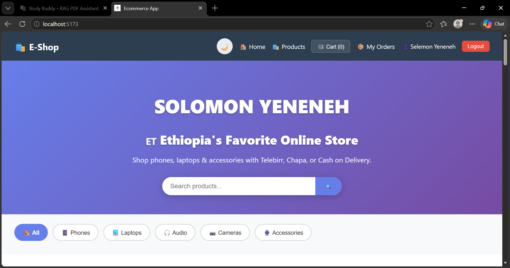
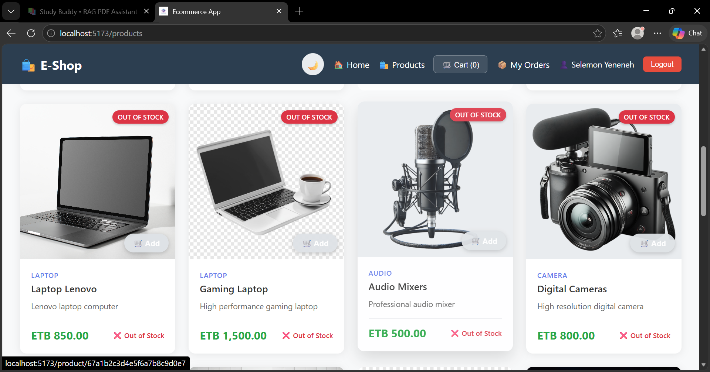

# Electronic Shop Management System

## 🚀 Overview
A full-stack system for managing an electronic shop including products, orders, and users.

---

## 🖼️ Preview

### Dashboard / UI Preview


### Product Preview


---

## 🛠 Tech Stack
- Frontend: React  
- Backend: Node.js / Express  
- Database: MongoDB  

---

## 📦 Installation

```

## Google sign-in verification

Google sign-in and Google sign-up require a reCAPTCHA v2 checkbox before redirecting to Google. Create a reCAPTCHA v2 site key for the frontend domains and configure:

- `VITE_RECAPTCHA_SITE_KEY` in the frontend environment
- `RECAPTCHA_SECRET_KEY` in the backend environment

The backend verifies each reCAPTCHA response with Google and blocks the OAuth redirect unless verification succeeds. Restart/rebuild the frontend after setting its site key. Google sign-in remains unavailable until both keys are configured.bash
npm install
npm start
